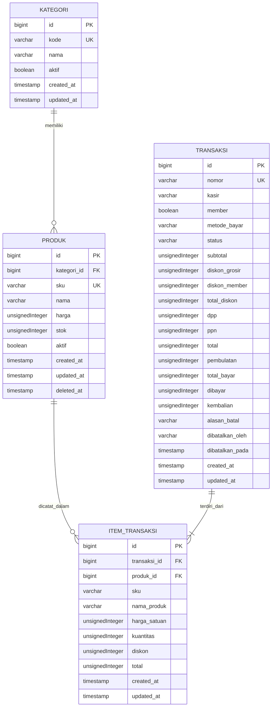

# ERD — Sistem POS Modul 4

## Catatan relasi

- Satu kategori memiliki banyak produk.
- Satu transaksi memiliki item transaksi.
- Satu produk dapat tercatat pada banyak item transaksi.
- Item transaksi menyimpan snapshot SKU, nama produk, dan harga satuan agar riwayat transaksi tetap terbaca ketika data produk berubah.
- `created_at`, `updated_at`, dan `deleted_at` ditampilkan sesuai penggunaan timestamps dan soft deletes.
- Relasi foreign key mengikuti aturan penghapusan yang didefinisikan pada migration.
